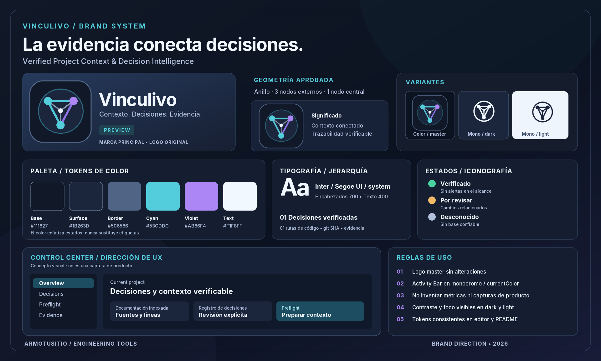
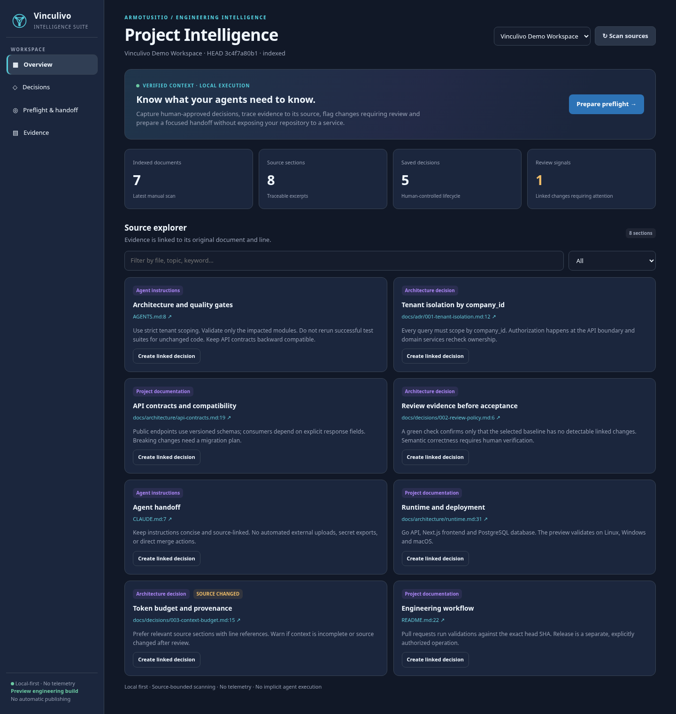
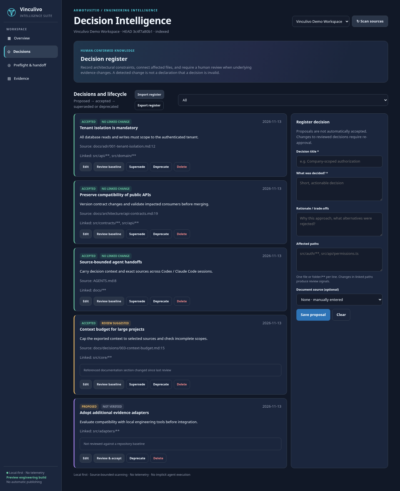
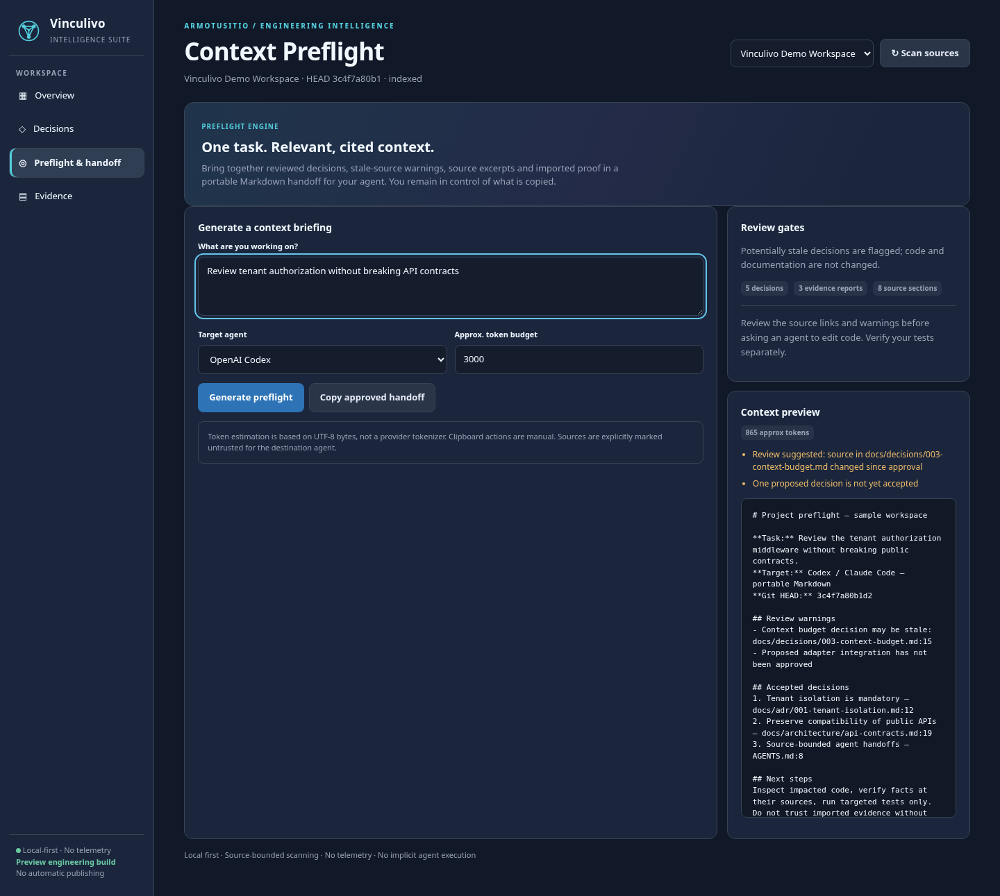
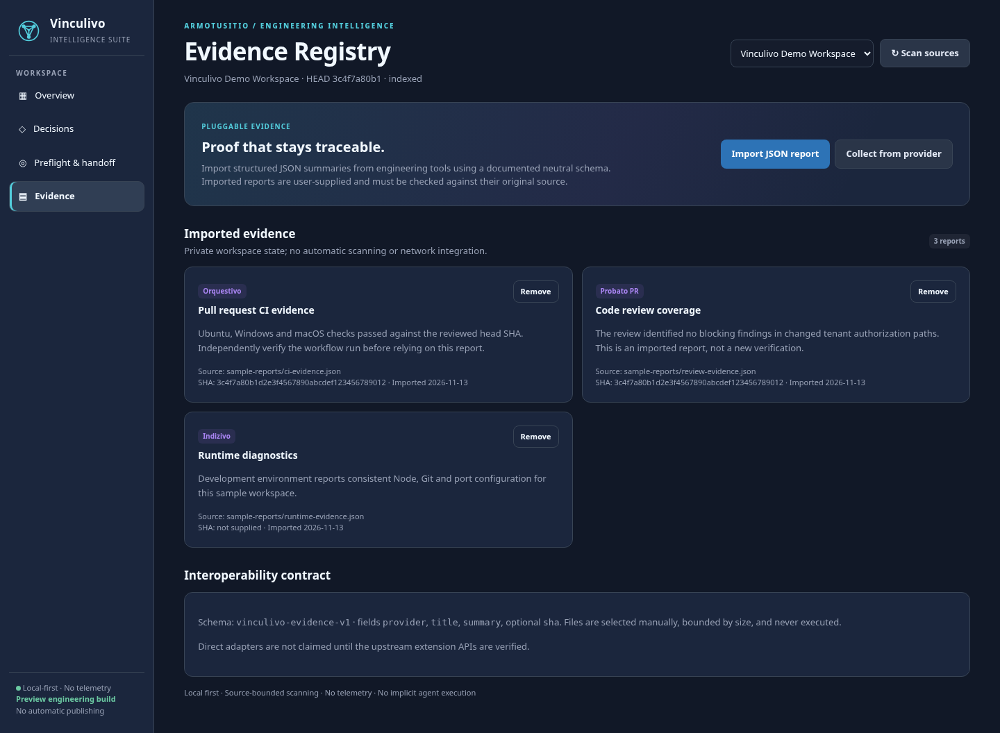

<div align="center">
  

# Vinculivo
### Verified Project Context & Decision Intelligence

**Decisions with provenance. Change signals with evidence. Context your agents can actually use.**

[ArmoTuSitio](https://armotusitio.com.ar) · VS Code / ArmoTuSitio IDE · TypeScript · Local-first

</div>

> [!IMPORTANT]
> **v0.2.0 — Preview candidate.** The repository is **public**, but publishing the extension to VS Code Marketplace / Open VSX is a **separate step** and is **not yet confirmed**. `package.json` sets `preview: true` for the eventual public preview. The PR CI generates an Actions VSIX for manual validation; real IDE UX acceptance is pending.

## Why Vinculivo exists

Every engineering project accumulates architectural decisions, agent instructions, constraints, verification evidence and hidden knowledge. AI coding tools often start sessions without the context needed to respect those agreements. Vinculivo brings that context into the editor, linked to its evidence, without sending your repository to an external service.

Vinculivo is **not another chatbot**. It is a project-context and decision governance extension supporting a full workflow: **discover → register → link → verify → detect changes → preflight → handoff**.

## Identidad de marca / Brand identity



El logo aprobado es **la fuente de verdad**: anillo circular, tres nodos exteriores, nodo central y conexiones en cian/violeta. No se cambió el símbolo; las adaptaciones conservan su geometría. El icono de Activity Bar utiliza una variante monocromática con `currentColor`.

- [Manual de identidad, uso de logo y guía UX/UI](docs/BRAND_IDENTITY.md)
- [Moodboard en SVG editable](media/brand/vinculivo-moodboard.svg) · [PNG de alta resolución](media/brand/vinculivo-moodboard.png)
- [Inventario de assets y procedencia](docs/BRAND_ASSETS.md) · [Design tokens CSS](media/brand/tokens.css)

**Nota:** el panel ilustrado dentro del moodboard es una propuesta de dirección visual. Las futuras capturas funcionales deben proceder del Extension Host real, no de renders o mockups.

## What works in this Preview candidate

| Area | Capability | Guarantees and boundaries |
| --- | --- | --- |
| **Source intelligence** | Bounded indexing of `AGENTS.md`, `CLAUDE.md`, root `README.md` and Markdown ADR/architecture/decisions/design documents. Each section includes source location and SHA-256 fingerprint. | Explicit scan in trusted workspaces; local or `vscode-remote` file providers. Skipped/partial indexing is reported. |
| **Decision register** | Create, edit, remove, accept, supersede and deprecate decisions. Record rationale, source Markdown and linked repository paths. | Decisions begin as proposals; editing an accepted decision **revokes prior review**. User confirmation is required to accept. |
| **Change intelligence** | Compare linked file fingerprints and Git changes from the reviewed SHA, including working-tree modifications and untracked files, against review baselines. | Changes trigger **review suggested**, not claims of semantic invalidity. Unavailable evidence becomes **unknown**, never a fabricated PASS. |
| **Preflight** | Prioritize relevant decisions, documentation and imported evidence for a task; report unknown or potentially stale decisions. | Deterministic local ranking, no remote LLM dependency. |
| **Agent handoff** | Generate source-referenced Markdown for Claude Code, Codex, GitHub Copilot or a neutral consumer; preview and manually copy. | Byte-based approximate token budget, configurable limits and heuristic redaction; not a model-exact tokenizer or secret guarantee. |
| **Portable decision register** | Export/import a JSON decision bundle after explicit user confirmation. | Imported decisions are always **unreviewed proposals**, even when the source bundle claims acceptance. |
| **Evidence ecosystem** | Explicitly import JSON reports using `vinculivo-evidence-v1`. Extensions can register opt-in providers through the exported API. | Imported reports are third-party/user-provided assertions, **not independently validated**. No claim of live integration until adapters are implemented upstream. |
| **Control Center** | Full editor-area workbench with Overview, Decisions, Preflight and Evidence, filtering, responsive layout, source navigation and keyboard focus states. | Activity Bar icon monochrome and derived from the official logo. Theme-aware colors, strict Webview CSP. |
| **Engineering hygiene** | Modular TypeScript, tests for parser, lifecycle, signals, budgets, portability and Webview script syntax. | PR CI runs Ubuntu, Windows and macOS against the exact PR head; VSIX candidate produced on Linux only. No automatic release. |

### UI and brand

The top brand icon and `media/brand/vinculivo-activity-bar.svg` share the **same actual geometry**: thin circular boundary, three outer nodes, a central fourth node and a triangular set of links. The Activity Bar is **monochrome (`currentColor`)**, following VS Code theme conventions. The Control Center opens in the **main editor**, not in a compressed sidebar.

## Screenshots — actual Control Center renderer

The four screenshots below are captured from **Vinculivo’s actual `src/ui.ts` Webview implementation**, rendered in headless Chromium with a **deterministic, synthetic example workspace**. They show implemented UI, not the conceptual brand moodboard. **They are not screenshots of an installed VS Code / ArmoTuSitio IDE Extension Host**, whose native visual acceptance remains pending. No private project data was used.

### 1. Overview — project intelligence

Documents indexed, linked source sections, decisions and signals requiring review, with file-and-line source navigation.



### 2. Decisions — human-confirmed knowledge

Decision lifecycle (proposed, accepted, superseded and deprecated), change warnings, linked files and the decision editor.



### 3. Preflight and agent handoff

Task-specific context selection, target agent, approximate token budget, review warnings and a source-referenced Markdown preview.



### 4. Evidence registry

Imported evidence summaries, their providers and provenance; reports remain unverified until checked against their original sources.



**Reproducibility:** `scripts/readme-fixture.cjs` contains only synthetic records. Build the extension (`npm run build`), then run `scripts/capture-readme-screenshots.py` with Python Playwright and Chromium (`VINCULIVO_CHROMIUM` may specify the executable). The script captures the **same Webview HTML renderer shipped by the extension** and checks for runtime JavaScript errors. Genuine VS Code / ArmoTuSitio IDE Extension Host screenshots are still part of the [Preview acceptance checklist](docs/PRIVATE_TEST_PLAN.md).


## Quick start — Preview validation

1. Open [the PR](https://github.com/Drako01/vinculivo/pull/1) and its green GitHub Actions run.
2. Download the **`vinculivo-private-vsix`** artifact, unzip it and verify the `.vsix.sha256` checksum.
3. In **ArmoTuSitio IDE** or VS Code: **Extensions → `…` → Install from VSIX…**. Select `vinculivo.vsix` and reload the window.
4. Open a project in a trusted workspace and click the **Vinculivo** Activity Bar icon. The actual Control Center opens in the editor area.
5. Click **Scan sources**. Explore the documented sections and open a source line.
6. Open **Decisions**, create a proposal, link it to `src/...` or `folder/**`, then explicitly **Review & accept** after checking the code.
7. Change a linked file, rescan and check the **review suggested** signal. Open **Preflight & handoff** to create a task-specific briefing with the new warning.
8. Preview the Markdown and use **Copy approved handoff** (copy means user-approved export, not proof that decisions are correct). Paste where needed.

### Installation from source

Requires **Node.js 22+**, npm and VS Code API `^1.96.0`.

```bash
git clone https://github.com/Drako01/vinculivo.git
cd vinculivo
npm ci --ignore-scripts --no-audit --no-fund
npm run verify
npm run package:vsix
```

> The repository is public. `npm run package:vsix` creates a candidate locally; it never publishes a release. The generated CI artifact is a validation candidate, not proof of Marketplace/Open VSX publication.

## Decisions: what is reviewed, what is merely detected?

Vinculivo distinguishes **workflow state** and **evidence state**:

- **Proposed:** a developer entered or imported the decision; it is not accepted.
- **Accepted:** a developer explicitly acknowledged reviewing the sources and affected paths. This is **not** a formal correctness proof.
- **Review suggested:** a referenced document or linked file appears changed, or a Git diff touches a linked directory. Human confirmation is needed.
- **Unknown:** no reliable review baseline exists, or Git/linked evidence is unavailable.
- **Superseded / deprecated:** historic decisions remain visible but do not control new task preflights.

A clean signal means only *no relevant changes were detected within the checked scope*. It never means the decision is universally correct. Individual files are fingerprinted on review. Directory patterns such as `src/auth/**` are monitored through Git diffs from that SHA; a missing Git repository limits those signals.

## Preflight and token economy

The selected task is used to score titles, source paths, excerpts and decisions without calling a model. Handoffs include:

1. The selected task and Git HEAD.
2. Review warnings, not hidden behind a "green" summary.
3. User-reviewed decision summaries, rationale and related paths.
4. Relevant sourced Markdown excerpts with file, line and digest.
5. Explicitly imported third-party evidence, labeled **unverified**.
6. Instructions to verify code and **avoid repeating tests on unchanged code**.

A maximum-size budget is enforced using UTF-8 bytes divided by four as an **approximation** of token count; this is **not** exact for any proprietary tokenizer. The preview is generated locally. Clipboard export requires a user action.

## Evidence integration

Generic JSON reports can be imported manually; direct extension-to-extension adapters require the respective extension to register a compatible evidence provider. This design avoids undocumented coupling to the release internals of Probato PR, Indizivo, Orquestivo, Saturivo, Noditrivo and Vestigivo RCA.

Example file:

```json
{
  "schema": "vinculivo-evidence-v1",
  "provider": "Orquestivo",
  "title": "PR #127 checks",
  "summary": "Validated unit and CI checks against the referenced commit",
  "sha": "aaaaaaaaaaaaaaaaaaaaaaaaaaaaaaaaaaaaaaaa"
}
```

Read [the evidence adapter contract](docs/EVIDENCE_INTEGRATION.md). Source references and imported claims must be independently reviewed.

## Workspace, privacy and security

Vinculivo makes **no automatic external API request**, sends **no telemetry**, and does not run or control AI agents. No automatic Git writes or shell scripts are executed. Repository scanning is explicit and requires Workspace Trust. Local Git reads use `execFile` without a shell and a timeout; `git` is optional. Path traversal and local symlink escapes are rejected.

- Indexed excerpts remain in extension memory; workspace-state storage retains documentation fingerprints, user-entered decisions and imported summaries.
- Exporting bundles **writes a file only at the user-selected destination**. Imported decisions must be re-reviewed.
- Clipboard content may be readable by other applications. **Review it before pasting into external assistants.** Heuristic credential redaction is not a DLP system.
- Documentation contents are untrusted. Handoffs explicitly warn destination agents not to follow embedded instructions as higher-priority commands.
- A `vscode-remote` provider may be indexed through the VS Code FS API; local Git comparisons are unavailable there, so baselines become unknown instead of green.

Full disclosures and responsible reporting: [SECURITY.md](SECURITY.md).

## Architecture

```text
src/
  core.ts          Bounded Markdown parser, source fingerprints, context selection
  intelligence.ts  Decision lifecycle, change signals, preflight, portable handoff
  bundle.ts        Import/export decision bundle (always downgrade imported approvals)
  storage.ts       Workspace-scoped decision/evidence state
  scan.ts          VS Code FS + filesystem containment + bounded Git comparisons
  ui.ts            CSP-restricted theme-aware Control Center Webview
  extension.ts     Commands, state transitions, guarded user actions, evidence API
```

See [architecture and threat model](docs/ARCHITECTURE.md), [user guide (ES)](docs/GUIA_DE_USO_ES.md), and [QA matrix](docs/PRIVATE_TEST_PLAN.md).

### Commands

| Command | Purpose |
| --- | --- |
| `Vinculivo: Open Control Center` | Open the central workbench |
| `Vinculivo: Scan Project Documentation` | Explicitly index eligible documents |
| `Vinculivo: Copy Context Handoff` | Copy a generated portable context after scan |
| `Vinculivo: Collect Registered Evidence` | Ask a manually selected registered provider for reports |

Settings: `vinculivo.maxHandoffChars` (default `50000`, maximum `50000`). Token budget is also configurable in the Preflight UI.

## Build, verification and governance

```bash
npm ci --ignore-scripts --no-audit --no-fund
npm run typecheck
npm run test
npm run package:vsix
```

CI is **PR/manual only**, checking the same head SHA on `ubuntu-latest`, `windows-latest` and `macos-latest`. VSIX and checksum are uploaded **only** by Linux as **private Actions artifacts**. The `main` merge path does not re-execute the full suite or publish to GitHub Releases, Open VSX or Marketplace. Public distribution requires a separate explicit authorization.

## Known boundaries (deliberate, not hidden)

- No LLM embeddings, private provider history ingestion, or claim of semantic proof. Deterministic local ranking provides traceability, not "AI understands your entire codebase".
- Documentation scan is bounded (up to 900 discovered Markdown files, 180 eligible files, 150 KB each, and up to 40 sections/file); incomplete scans are visible. Non-indexed files must not be treated as deleted.
- One selected workspace root is analyzed at a time; switching roots isolates decisions and evidence.
- Native remote Git history and extension-specific third-party report formats require independently verified adapters.
- Actual visual QA in ArmoTuSitio IDE, accessibility testing in a real extension host and real README captures remain private acceptance gates before a public release. We do not call those complete without evidence.

## Español — resumen

**Vinculivo** es una extensión de inteligencia de contexto para VS Code y ArmoTuSitio IDE: indexa documentación, registra decisiones aprobadas por humanos, detecta cambios en archivos relacionados, prepara contextos específicos para Claude Code/Codex/Copilot y permite importar evidencia verificable. No envía información a terceros automáticamente; todas las exportaciones son explícitas. El desarrollo y el PR siguen **privados** hasta completar pruebas reales en el IDE.

Para el paso a paso y ejemplos, consultá [Guía de uso (Español)](docs/GUIA_DE_USO_ES.md).

---

<div align="center">

**ArmoTuSitio Engineering Tools** · [ArmoTuSitio](https://armotusitio.com.ar) · [GitHub](https://github.com/Drako01)

MIT License · © 2026 Alejandro Daniel Di Stefano

</div>
