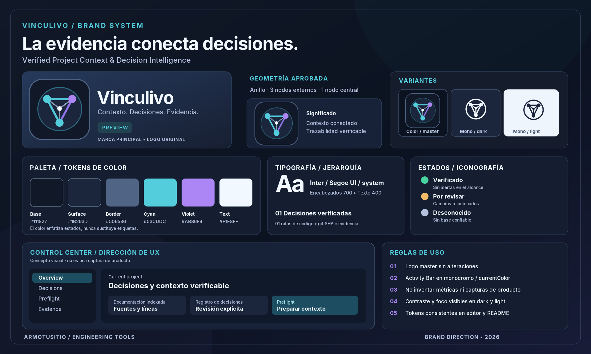

# Brand assets / inventario de medios

La marca gráfica está basada **exclusivamente** en el logo aprobado `vinculivo-icon-256.png`.

| Asset | Formato | Propósito | ¿Apto para UI del IDE? |
| --- | --- | --- | --- |
| [`vinculivo-icon-256.png`](../media/brand/vinculivo-icon-256.png) | PNG 256×256 | Master oficial de logo / Marketplace | Sí; se mantiene sin cambios |
| [`vinculivo-activity-bar.svg`](../media/brand/vinculivo-activity-bar.svg) | SVG `currentColor` | Monocromo para Activity Bar de VS Code | Sí |
| [`vinculivo-lockup-dark.svg`](../media/brand/vinculivo-lockup-dark.svg) | SVG | Portada / cabecera dark | No dentro de Activity Bar |
| [`vinculivo-lockup-light.svg`](../media/brand/vinculivo-lockup-light.svg) | SVG | Portada / cabecera light | No dentro de Activity Bar |
| [`vinculivo-moodboard.svg`](../media/brand/vinculivo-moodboard.svg) | SVG | Moodboard editable | Documentación solamente |
| [`vinculivo-moodboard.png`](../media/brand/vinculivo-moodboard.png) | PNG | Moodboard para README / GitHub | Documentación solamente |
| [`tokens.css`](../media/brand/tokens.css) | CSS | Tokens y referencia para UI | Sí, como referencia; respetar tema |

## Proveniencia y precisión

- `vinculivo-icon-256.png` no se regenera ni cambia; su firma SHA-256 queda verificada en `scripts/verify-brand.cjs`.
- Las variantes horizontales son **composiciones** del logo aprobado, no un rediseño.
- La variante de Activity Bar simplifica únicamente color y mantiene estructura (anillo circular + cuatro nodos).
- Las tarjetas del moodboard son **mockups conceptuales**, no capturas auténticas de la extensión y no describen cifras reales.
- La fuente SVG del moodboard incluye en base64 **el mismo PNG master** para preservar sus píxeles al renderizar.
- Materiales externos a los enumerados deben auditarse para evitar iconografía inconsistente.

Ver [manual de identidad](BRAND_IDENTITY.md).
