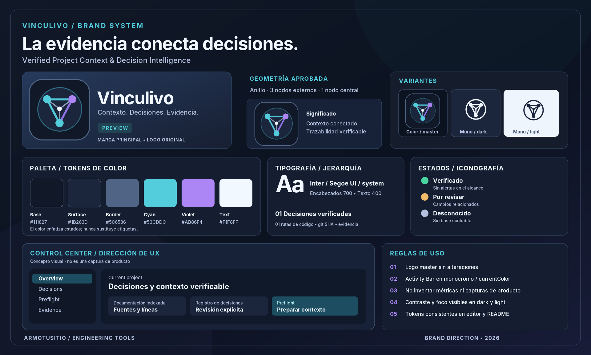

# Vinculivo · Identidad de marca

> **Brand system v1 · 2026-11-13 · Preview**  
> Fuente de verdad visual: [`media/brand/vinculivo-icon-256.png`](../media/brand/vinculivo-icon-256.png), el logo **aprobado**. Este documento define usos y aplicaciones; **no autoriza cambiar el símbolo**. Toda nueva variante debe respetar la estructura geométrica aprobada.  
> Alcance: ArmoTuSitio Engineering Tools / VS Code extension / ArmoTuSitio IDE.

[Ver moodboard PNG completo](../media/brand/vinculivo-moodboard.png) · [SVG editable](../media/brand/vinculivo-moodboard.svg)

## 1. Propósito, identidad y voz

**Nombre:** Vinculivo.  
**Descriptor:** Verified Project Context & Decision Intelligence.  
**Propuesta:** Conectar contexto, decisiones, código y evidencia verificable para que un proyecto conserve continuidad entre personas, sesiones y agentes de IA.  
**Claim principal:** **La evidencia conecta decisiones.**  
**Mensajes alternativos:** *Contexto. Decisiones. Evidencia.* · *Project memory grounded in evidence.*  
**Tono:** preciso, técnico, sereno y práctico. Nunca comunicar garantías de corrección que el análisis no puede demostrar.

**Prioridades de marca:** confianza y trazabilidad, continuidad entre sesiones, privacidad local, claridad de estados, economía de tokens, funcionamiento independiente de proveedores de IA.

## 2. Logos oficiales (reglas invariables)

| Artefacto | Uso | Estado |
| --- | --- | --- |
| [`vinculivo-icon-256.png`](../media/brand/vinculivo-icon-256.png) | Icono principal, extensión, README, Marketplace y Open VSX | **Aprobado / intocable** |
| [`vinculivo-activity-bar.svg`](../media/brand/vinculivo-activity-bar.svg) | Icono monocromático para la Activity Bar | Aprobado como adaptación del símbolo: `currentColor` |
| [`vinculivo-lockup-dark.svg`](../media/brand/vinculivo-lockup-dark.svg) | Presentaciones y cabeceras sobre fondos oscuros | Composición tipográfica con el PNG aprobado |
| [`vinculivo-lockup-light.svg`](../media/brand/vinculivo-lockup-light.svg) | Documentación y presentaciones sobre fondos claros | Composición tipográfica con el PNG aprobado |
| [`vinculivo-moodboard.png`](../media/brand/vinculivo-moodboard.png) | Vista general del sistema visual | **Moodboard conceptual, no screenshot real** |
| [`vinculivo-moodboard.svg`](../media/brand/vinculivo-moodboard.svg) | Versión vectorial del moodboard para adaptación | Fuente editable de la presentación |

### Geometría y significado

El símbolo utiliza un **anillo circular**, **tres nodos externos conectados triangularmente** y **un nodo central** conectado a los externos. La red comunica relaciones y evidencia compartida; el círculo comunica continuidad del contexto. Esta es la geometría definida por el PNG aprobado. El símbolo de Activity Bar debe conservarla y **nunca convertirse en un cubo o hexágono**.

**No alterar:** relación de posición de nodos, estructura de enlaces, proporción del anillo, silueta del icono, colores del master, radios del contenedor ni su orientación.

### Separación y escalado

- Icono oficial: usar el PNG original a escala uniforme. Mínimo recomendado **32×32 px** en web y **128×128 px** para galerías; usar tamaños superiores cuando el contexto lo permita. Nunca interpolar con arte de píxel distinto.
- Zona de seguridad para composiciones: mínimo **12,5 %** de la anchura de la caja del icono respecto a otros elementos. No colocar texto encima del anillo ni de los nodos.
- Lockup horizontal: conservar una separación visual equivalente a ~**0,15×** del lado del icono entre símbolo y palabra.
- Activity Bar: siempre SVG monocromático (`currentColor`, sin fondo, sin gradientes) para respetar temas de VS Code. En pantallas pequeñas, evaluar la legibilidad a **24 px**.
- Las variantes horizontal dark/light son **composiciones del logo oficial y tipografía**, no rediseños ni un segundo logotipo aprobado.

### Usos incorrectos

- No reutilizar el SVG de cubo/hexágono del primer PR.
- No cambiar el nodo central por un candado, un cerebro o un destello de IA.
- No sustituir `currentColor` por colores de marca en la Activity Bar.
- No distorsionar la relación de aspecto, aplicar sombras fuertes al símbolo o crear versiones raster de baja calidad.
- No representar capturas de conceptos como evidencia de implementación.

## 3. Color: paleta a partir del PNG real

Los colores principales se extrajeron de los píxeles del icono aprobado. `tokens.css` contiene las variables de uso:

| Token | Hex | Uso |
| --- | --- | --- |
| `--vinculivo-bg` | `#111827` | Fondo principal |
| `--vinculivo-deep` | `#0B1220` | Superficie de profundidad para documentación y gráficos |
| `--vinculivo-surface` | `#1B263D` | Cards y paneles elevados |
| `--vinculivo-border` | `#506586` | Bordes y contenedores |
| `--vinculivo-cyan` | `#53CDDC` | Acción, foco, relaciones principales |
| `--vinculivo-cyan-alt` | `#50C7D7` | Nodo inferior / variación del cyan |
| `--vinculivo-purple` | `#AB86F4` | Contexto secundario, decisiones, vínculos |
| `--vinculivo-purple-alt` | `#9072E7` | Segundo violeta de nodos |
| `--vinculivo-text` | `#F1F8FF` | Texto principal en dark |
| `--vinculivo-muted` | `#B4C1DE` | Texto secundario |
| `--vinculivo-success` | `#48D3A0` | Evidencia revisada / estado positivo |
| `--vinculivo-warning` | `#F3BB68` | Revisión sugerida / incertidumbre |
| `--vinculivo-error` | `#FB8296` | Error / bloqueo explícito |

**Contraste comprobado con WCAG:** `#F1F8FF` sobre `#111827` ≈ **16.57:1**, `#B4C1DE` sobre `#1B263D` ≈ **8.35:1**, `#53CDDC` sobre `#111827` ≈ **9.41:1** y `#AB86F4` sobre `#111827` ≈ **6.29:1**. Esas combinaciones superan AA para texto normal; evaluar toda nueva combinación en el contexto real y nunca asumir contraste por compartir un token.

### Semántica

- **Cyan:** principal, acciones, navegación y vínculos de fuente.
- **Purple:** conexión de decisiones y estado contextual.
- **Green:** confirmación explícita tras una revisión humana; nunca deducir *correctitud* solo por ausencia de cambios.
- **Amber:** revisión pendiente o señal de potencial obsolescencia, no error confirmado.
- **Red:** fallo operacional o bloqueo.
- **Gray/slate:** desconocido, no evaluado, deshabilitado, texto auxiliar.

Usar **color + icono + etiqueta** en todos los estados. Reservar gradientes para fondos atmosféricos y superficies de marketing; nunca en el icono monocromático ni como única señal de estado.

## 4. Tipografía

- **UI:** `Inter` si está disponible, luego `Segoe UI`, luego la fuente de interfaz de VS Code, después `system-ui`.
- **Código, hashes, rutas:** fuente monoespaciada del editor (`--vscode-editor-font-family`) con fallback monospace.
- **Pesos:** 750–700 hero/título, 650–600 subtítulos y controles, 400–500 texto corrido.
- **Escala recomendada:** título 28–34 px, sección 18–20 px, componentes 13–15 px, microcopy no menor de 11 px cuando sea legible.
- **Longitud:** evitar subtítulos que dependan de un ancho fijo, y no truncar los hashes SHA sin permitir ver el valor completo.

## 5. Espaciado, componentes y UX

**Escala de espaciado:** `4, 8, 12, 16, 24, 32, 48 px`. **Radios:** botones 8 px, cards 12 px, hero 16 px. **Borde:** 1 px con color del tema cuando corresponda; para estados seleccionados, acento más borde/foco visible.

### Control Center: dirección de producto

- Se abre en el **editor central**, no como un dashboard completo apretado en la sidebar.
- Navegación primaria limitada y clara: **Overview, Decisions, Preflight, Evidence**; usar acciones directas y breadcrumbs cuando una operación esté anidada.
- Mostrar siempre **fuente, ubicación, estado de revisión y restricciones** de la evidencia.
- Una decisión aceptada por usuario no equivale a garantía de corrección; una fuente sin base actualizada debe mostrarse **Unknown**, nunca verde.
- Formularios con etiquetas persistentes, mensajes específicos, estados de carga, botón deshabilitado razonado, foco de teclado y semántica ARIA.
- Mantener compatibilidad con temas claros y oscuros. Las variables VS Code tienen prioridad para superficies y texto del workbench; los colores de marca se usan como acentos de identidad.
- Evitar animaciones que dificulten leer, imágenes pesadas dentro del webview y cambios de layout que provoquen saltos.
- No añadir métricas inventadas. El moodboard utiliza ejemplos esquemáticos, **sin números reales de uso ni screenshots auténticas**.

### Experiencia de handoff

- Previsualizar contenido y presupuesto antes de copiar/exportar.
- Mostrar el límite de tokens como **estimación**, no como conteo exacto del modelo.
- Advertir de fuentes desconocidas u obsoletas en el mismo panel de preflight.
- Respetar Workspace Trust; no enviar contenido a terceros sin una acción explícita.

## 6. Aplicaciones aprobadas

**README:** logo oficial + explicación de producto + moodboard etiquetado como concepto + capturas reales de la extensión cuando se hayan probado.  
**Marketplace/Open VSX:** icono PNG aprobado, descriptor claro, `preview: true` mientras dure la etapa Preview, `galleryBanner.color` coherente. No afirmar disponibilidad hasta haber publicado efectivamente.  
**Activity Bar:** SVG mono registrado en `package.json`, sin variantes cromáticas.  
**Header Control Center:** símbolo mono y nombre de producto, no una creación alternativa del logo.  
**Material promocional:** variantes dark/light, sin deformaciones; no incluir estrellas/descargas ficticias.

## 7. Materiales, custodia y evolución

1. **Fuente de verdad del símbolo:** PNG de 256 px aprobado y preservado en Git. Cualquier cambio del logo master requiere autorización expresa.
2. **Derivados:** composiciones SVG y moodboard documentado. Son editables; el símbolo permanece bloqueado.
3. **Tests:** comprobar bytes de PNG, legibilidad visual de 24 px y compatibilidad light/dark; validar renderizado SVG y rutas del manifiesto.
4. **Capturas reales:** obtenidas desde VS Code/ArmoTuSitio IDE, con versión y entorno indicados; nunca fabricar una screenshot de producción con un mockup.
5. **Preview:** el branding está preparado para exposición pública del repositorio, pero el paquete publicado es un paso independiente y debe estar respaldado por pruebas reales.
6. **Transición a estable:** cambiar `preview` a `false` únicamente con aprobación expresa y checklist de calidad cerrado.

## 8. Checklist visual previo al merge

- [x] Moodboard generado usando el **PNG original inalterado**.
- [x] Variantes de lockup dark y light como composición, sin nuevo símbolo.
- [x] Icono SVG de Activity Bar derivado de la geometría aprobada.
- [x] Tokens documentados y contrastes principales comprobados.
- [x] README con enlace al sistema visual y estado Preview correcto.
- [ ] Verificar representación a 24 px en el Activity Bar real de ArmoTuSitio IDE y VS Code.
- [ ] Capturas auténticas del Control Center en el editor central con tema dark y light.
- [ ] Evaluación de teclado, zoom 200 %, screen reader y distintos tamaños de ventana.
- [ ] Validar visualmente el VSIX generado a partir del SHA aprobado.

**Nota de gobierno:** el moodboard es un documento de dirección de marca. No equivale a evidencia de que la UX/UI final haya pasado aceptación humana.
